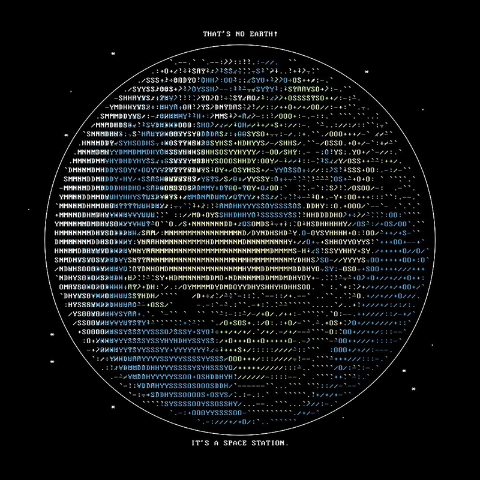

<div align="center">

# ascii-earth

**Render the planets, the Moon and the Sun as a live terminal globe**

</div>

A real equirectangular texture is back-projected onto a sphere (orthographic projection), sampled per terminal cell and recoloured. The disc sits in a full starfield, captions pin to the top and bottom edges, and everything is driven live from the keyboard and the mouse — day/night by the real Sun, Saturn's rings, real relative sizes and a pile of palettes. Textures are bundled, so it runs offline.

## ■ Features

- ❖ **11 bodies** — Earth, Sun, Mercury, Venus, Moon, Mars, Jupiter, Saturn, Uranus, Neptune, Ceres; switch on the fly with `<` / `>`
- ❖ **Rings** — Saturn and Uranus get an ellipse with proper sphere occlusion (front arc over the disc, back arc hidden), a Cassini-style gap and azimuthal clumps so the spin is visible
- ❖ **Real-time day / night** (`--sun`) — lit by the actual current sub-solar point; the night side fades to bright black-and-white
- ❖ **Follow the Sun** (`--follow`) — a Sun-locked view that always shows the day side while Earth turns under it at the real rate (one turn per 24 h)
- ❖ **Scale modes** (`m`) — `fit`, `real` (true relative radii: the Sun is a wall, Ceres is a dot) and `sqrt` (a readable compromise)
- ❖ **3 glyph modes** (`g`) — braille (2×4 sub-pixel, default), a dense 56-level UTF-8 ramp, and plain ASCII
- ❖ **10 palettes** (`p`) — natural, political, blue, green, amber, ice, mono, inferno, neon, catppuccin
- ❖ **Mouse + keyboard**, truecolor / 256 / mono output, works over tmux & mosh

## ■ Stack

<div align="center">

| Component | Technology |
|-----------|-----------|
| Language | Python 3.9+ |
| Image sampling | Pillow |
| Vector maths | NumPy |
| Projection | Orthographic back-projection, per-cell texture sampling |
| Output | ANSI truecolor / 256-colour, Braille & UTF-8 glyphs |
| Input | termios raw mode, SGR mouse |
| Day/night | Sub-solar point from UTC (declination + hour angle) |
| Textures | NASA Blue Marble (PD) + Solar System Scope (CC-BY 4.0) |

</div>

## ■ How It Works

```
1. Pick a body — its equirectangular texture is loaded (bundled, offline)
2. Each terminal cell is back-projected onto the sphere and the texture is sampled there
3. Braille mode supersamples every cell into a 2x4 dot matrix; the disc is laid out as a viewport and clips at the edges
4. A palette recolours the surface; the starfield fills the rest of the screen
5. --sun shades a soft terminator from the real sub-solar point; rings draw as an occluded ellipse
6. Keyboard and mouse drive rotation, zoom, body, scale, palette and day/night live
```

## ■ Screenshots

<div align="center">


*Earth in the natural palette, rotating in a real terminal*


*Saturn and Uranus rendered with their rings*



*The original ASCII poster that inspired ascii-earth*

</div>

## ■ Usage

```bash
# Install: one folder with Python and the maps inside, nothing else needed (macOS, Linux)
curl -fsSL https://raw.githubusercontent.com/pluttan/ascii-earth/main/install.sh | sh
# or Homebrew
brew install pluttan/tap/ascii-earth
# or by hand: an archive per OS and CPU on the Releases page
# or with your own Python
pip install "git+https://github.com/pluttan/ascii-earth"

# Interactive (keyboard + mouse)
ascii-earth -i

# One-shot posters
ascii-earth --body saturn --lat 26      # Saturn, rings open
ascii-earth --sun                       # Earth right now: day & night
ascii-earth --scale real --body mars    # true relative size
ascii-earth --palette catppuccin --color truecolor
```

## ■ Textures & Attribution

Textures are bundled and keep their own licenses: **Earth** — NASA Blue Marble, public domain; **all other bodies** — [Solar System Scope](https://www.solarsystemscope.com/textures), **CC-BY 4.0** (attribution required).

## ■ License

MIT © [pluttan](https://github.com/pluttan)
